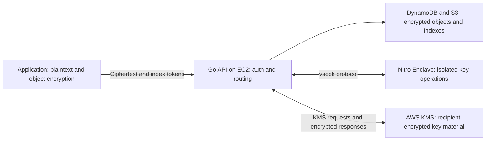

<div align="center">

<picture>
  <source media="(prefers-color-scheme: dark)" srcset="apps/landing/src/assets/logo-white.svg">
  
</picture>

### Encrypted data infrastructure. Built in the open.

An open-source encrypted data layer for AWS: encrypt objects in your application,<br>
store ciphertext in DynamoDB and S3, and keep key operations in attested Nitro Enclaves.

[](https://github.com/QodeSrl/Gardbase/actions/workflows/ci.yml)
[](LICENSE)
[](go.work)
[](https://aws.amazon.com/ec2/nitro/nitro-enclaves/)

[Quick start](#quick-start) · [Architecture](#architecture) · [Security model](#security-model) · [API reference](apps/api/README.md) · [Deployment](infrastructure/README.md) · [Contributing](CONTRIBUTING.md)

</div>

## Overview

Gardbase applications encrypt object contents locally. A Go REST API stores the ciphertext in DynamoDB and S3, and an AWS Nitro Enclave handles key operations through attested sessions.

The repository contains the API, enclave service, client crypto packages, landing page, and Terraform configuration. Build an integration with the REST endpoints and Go primitives; an ORM-style collection SDK is not included.

## What you can build with it

- **Encrypted objects:** AES-256-GCM object encryption in your application, using per-object data encryption keys (DEKs).
- **Attested key sessions:** client verification of enclave attestations and session-sealed key material.
- **Encrypted queries:** deterministic equality tokens and order-preserving range tokens, with explicit information-leakage tradeoffs.
- **Two storage paths:** inline encrypted objects in DynamoDB and presigned S3 uploads for larger payloads.
- **Object lifecycle:** versioned writes, pagination, soft deletion, and recovery.
- **Tenant-scoped access:** API keys with `read`, `write`, and `crypto` permissions.
- **Self-hosting:** Docker build targets and Terraform configuration for your AWS account.

## Quick start

### Run the landing page

The website runs independently of AWS and the Go services. Use Node.js **22.14.0 or newer** and the pnpm version in [`package.json`](package.json), currently **12.6.0**.

```bash
git clone --branch development https://github.com/QodeSrl/Gardbase.git
cd Gardbase
pnpm install --frozen-lockfile
pnpm dev:landing
```

Open the local URL printed by Vite, normally `http://localhost:3000`.

```bash
pnpm check:landing
pnpm build:landing
pnpm preview:landing
```

The production output is `dist/apps/landing`. The interactive encryption demo runs entirely in the browser and does not connect to an enclave or database. See the [landing page README](apps/landing/README.md) for development and accessibility details.

### Work on the data services

The Go modules use the toolchain version declared in [`go.work`](go.work), currently **1.27.1**. The running services also need AWS resources, an enclave-capable Linux host, and working vsock connectivity; starting them on a laptop is not a complete local database environment.

```bash
# From the repository root, with a compatible Go toolchain:
go build -o dist/apps/api/main ./apps/api/cmd/server
go build -o dist/apps/enclave-service/main ./apps/enclave-service/cmd/enclave
```

The crypto tests require an existing deployment and an adapted credential/verification setup; inspect [`kms_test.go`](pkg/crypto/kms_test.go) before running them. Building a service does not provision its AWS dependencies.

Continue with the [API setup and routes](apps/api/README.md), [enclave service](apps/enclave-service/README.md), [crypto package](pkg/crypto/README.md), and [deployment guide](infrastructure/README.md).

## Architecture



The API relays key material intended for the enclave. The enclave opens recipient-encrypted material and seals the required keys to the client session. The client can then encrypt or decrypt object contents locally. The enclave does not need a network connection to KMS; the parent API makes those requests.

A typical object workflow is:

1. Create a tenant and obtain its API key in a controlled deployment.
2. Establish an enclave session and verify its attestation against the expected measurements.
3. Resolve a table hash and obtain the required DEKs and index key through the session.
4. Encrypt object contents and derive index tokens in the application.
5. Store ciphertext through the inline or large-object API.
6. Query by token, retrieve ciphertext, and decrypt in the application.

See [`pkg/api`](pkg/api) for request and response types. JSON `[]byte` fields use Go's standard base64 encoding.

## Repository map

| Path                                                     | Responsibility                                                             |
| -------------------------------------------------------- | -------------------------------------------------------------------------- |
| [`apps/api`](apps/api/README.md)                         | HTTP routes, tenant authorization, storage, KMS, and enclave communication |
| [`apps/enclave-service`](apps/enclave-service/README.md) | Nitro Secure Module, attestation, sessions, and isolated key operations    |
| [`apps/landing`](apps/landing/README.md)                 | React and Vite website, with a standalone encryption demo                  |
| [`pkg/crypto`](pkg/crypto/README.md)                     | Session client, attestation verification, and object/index primitives      |
| [`pkg/api`](pkg/api)                                     | Go request and response types for the REST API                             |
| [`pkg/enclaveproto`](pkg/enclaveproto)                   | Parent-to-enclave message types                                            |
| [`pkg/models`](pkg/models)                               | Objects, indexes, tables, tenants, and API-key models                      |
| [`infrastructure`](infrastructure/README.md)             | Bootstrap and main Terraform configurations                                |

## Security model

Gardbase separates object encryption, key operations, and storage. The intended object flow keeps plaintext contents in the integrating application and sends ciphertext to the storage API. That boundary depends on the client, enclave verification, KMS policies, deployment configuration, and the code paths you use.

### Keys and sessions

- **AWS KMS keys** protect stored key material and produce recipient-encrypted material for the enclave.
- **Tenant master keys** participate in wrapping object keys. Table salts and per-table index encryption keys support table identification and token generation.
- **Object DEKs** encrypt contents with AES-256-GCM. Object keys are returned to clients sealed to an enclave session.
- **Session keys** protect key exchange between the application and enclave. Plaintext DEKs exist in application memory when it encrypts or decrypts an object.

The session client verifies the AWS certificate chain, COSE signature, nonce, and public-key binding. Configure a nonzero attestation age limit, enable `VerifyPCRs`, and supply the expected PCR measurements. A session with PCR checking disabled does not verify the expected enclave image. Read [`attestationVerification.go`](pkg/crypto/attestationVerification.go) and [`SessionConfig`](pkg/crypto/kms.go) when integrating.

### What encryption does and does not hide

| Mechanism                       | Purpose                  | Information still exposed                                                   |
| ------------------------------- | ------------------------ | --------------------------------------------------------------------------- |
| Probabilistic object encryption | Protect object contents  | Object sizes and operational metadata                                       |
| Deterministic equality tokens   | Match indexed values     | Repeated values and query/access patterns                                   |
| Order-preserving range tokens   | Compare indexed values   | Ordering, frequency, and distribution information; possible value inference |
| Tenant/API authorization        | Limit allowed operations | Access control does not replace encryption or transport security            |

Use range indexes only where that leakage is acceptable. Some OPE normalization functions also reduce precision, including `int64`, `float64`, and extended timestamps; review [`ope.go`](pkg/crypto/ope.go) for the selected type.

Identifiers, index names, timestamps, traffic patterns, and storage metadata are not all hidden by object encryption. A compromised client or accessible plaintext key can expose data. The additional `/api/encryption/decrypt` route unwraps KMS material through the enclave and returns it sealed to a client public key; it is separate from local object decryption. Review transport security, tenant provisioning, recovery, and backup procedures before a production deployment. Open source and enclave attestation do not by themselves establish a security audit or regulatory compliance.

## Development

Run JavaScript commands from the repository root. The existing Nx targets also cover the Go applications:

```bash
pnpm exec nx build @gardbase/api
pnpm exec nx build @gardbase/enclave-service
pnpm exec nx test @gardbase/api
```

The module paths use lowercase `github.com/qodesrl/gardbase`. The workspace links local modules through `go.work`; Docker builds use the module replacement declarations with `GOWORK=off`.

## Contributing

Contributions are welcome. Read [CONTRIBUTING.md](CONTRIBUTING.md) for the branch flow, local checks, and pull request expectations. Open an issue to discuss larger changes first.

Never include AWS credentials, API keys, plaintext production data, or Terraform state in an issue or pull request.

## Reporting a vulnerability

Do not open a public issue for security problems. Follow [SECURITY.md](SECURITY.md) to report privately.

## License

[Apache License 2.0](LICENSE). The software is open source; AWS resources and operating costs belong to the deployment owner.
